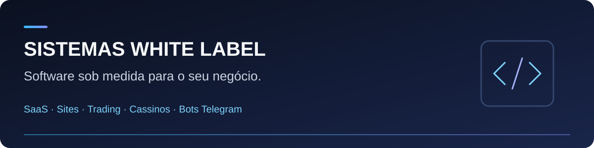

# Sistemas White Label | Desenvolvimento de software sob medida

Desenvolvo **SaaS, sites, plataformas de cassino, software para corretoras Forex e de opções binárias, robôs e bots para Telegram e salas de sinais**.

Trabalho com desenvolvimento sob demanda, personalização de sistemas e soluções white label para quem quer criar um produto com sua própria marca.

**[💬 Solicitar orçamento pelo WhatsApp](https://wa.me/5511910220770?text=Ol%C3%A1!%20Encontrei%20seu%20perfil%20no%20GitHub%20(Sistemas-Proficional)%20e%20gostaria%20de%20solicitar%20um%20or%C3%A7amento%20para%20meu%20projeto.)** · **[📂 Ver todos os repositórios](https://github.com/Sistemas-Proficional?tab=repositories)** · **[English](#custom-software-development)**

## O que desenvolvo

| Especialidade | Como posso ajudar |
| --- | --- |
| **SaaS e sistemas web** | Desenvolvimento de produtos digitais, ferramentas para empresas e plataformas white label. |
| **Sites e landing pages** | Criação de páginas para apresentar negócios, serviços e produtos. |
| **Plataformas de cassino** | Desenvolvimento e personalização de software para cassino online. |
| **Corretoras Forex e opções binárias** | Desenvolvimento de plataformas, painéis e integrações conforme o projeto. |
| **Bots Telegram e salas de sinais** | Criação de bots e automação da organização e distribuição de mensagens em canais e grupos. |
| **Robôs, APIs e automações** | Integração entre sistemas e automação de tarefas e processos. |

As funcionalidades e integrações são definidas conforme a necessidade do projeto e os recursos disponíveis em cada plataforma.

## Conheça meus projetos e soluções

Explore estas apresentações públicas para conhecer algumas das áreas em que trabalho:

| Área | Repositório |
| --- | --- |
| **Cassino online** | [Script completo de cassino](https://github.com/Sistemas-Proficional/SCRIPT-COMPLETO-CASSINO) |
| **Corretora de opções binárias** | [Broker white label — plataforma e funcionalidades](https://github.com/Sistemas-Proficional/broker-white-label-opcoes-binarias) |
| **SaaS sob medida e white label** | [Fábrica de SaaS — sistemas e possibilidades de personalização](https://github.com/Sistemas-Proficional/saas-white-label-plataforma-profissional-fabrica-de-saas) |
| **Bots para Telegram** | [Bots para salas de sinais](https://github.com/Sistemas-Proficional/BOT-SINAIS-TELEGRAM-) |

**[Explorar todos os repositórios públicos →](https://github.com/Sistemas-Proficional?tab=repositories)**

O conteúdo disponível e as condições de acesso ao código de cada solução estão descritos no respectivo repositório.

## Tem uma ideia de sistema?

Para conversar sobre um projeto, envie:

1. **O objetivo:** o que você quer criar ou melhorar.
2. **As funcionalidades:** o que o sistema precisa fazer.
3. **As integrações:** plataformas, APIs ou serviços que precisa conectar.
4. **As referências e o prazo:** exemplos do que procura e quando pretende começar.

**[Falar sobre meu projeto no WhatsApp →](https://wa.me/5511910220770?text=Ol%C3%A1!%20Encontrei%20seu%20perfil%20no%20GitHub%20(Sistemas-Proficional)%20e%20gostaria%20de%20solicitar%20um%20or%C3%A7amento%20para%20meu%20projeto.)**

## Perguntas frequentes

### Você desenvolve sistemas sob medida?

Sim. Trabalho com desenvolvimento de software sob demanda e personalização de plataformas, além de soluções white label.

### Você cria bots para minha plataforma?

Desenvolvo bots Telegram, robôs e automações para diferentes plataformas. A integração é avaliada conforme a API, a documentação e os recursos disponíveis.

### Como consultar valores e demonstrações?

Entre em contato com os detalhes do projeto para consultar o escopo, os valores e as demonstrações disponíveis para a solução desejada.

---

## Custom software development

I develop **SaaS products, websites, casino platforms, Forex and binary options brokerage software, Telegram bots, signal room automation and custom software integrations**.

My services include:

- Custom web applications and white label platforms.
- Websites and landing pages for businesses and digital products.
- Casino and brokerage software development and customization.
- Telegram bots for channels, groups and signal distribution.
- Robots, API integrations and workflow automation.

Explore the public repositories linked above for product descriptions and project information. Integration options depend on each platform's available APIs and features.

To discuss a project, share your goals, required features, integrations and expected timeline.

**[💬 Discuss a project on WhatsApp](https://wa.me/5511910220770?text=Hi!%20I%20found%20Sistemas-Proficional%20on%20GitHub%20and%20would%20like%20to%20discuss%20a%20software%20project.)** · **[📂 Browse all repositories](https://github.com/Sistemas-Proficional?tab=repositories)**
