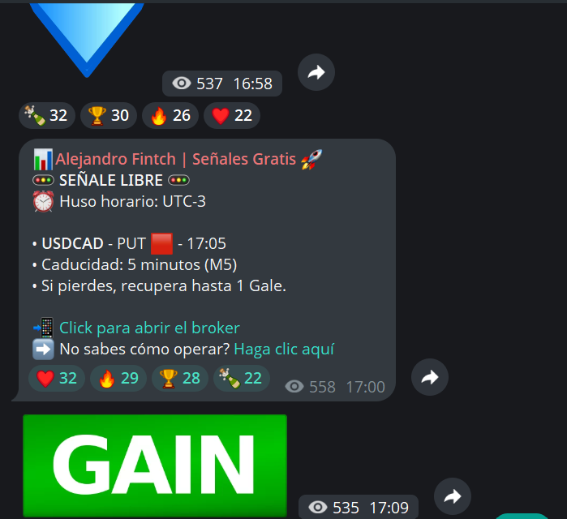

# Portafolio de plataformas y automatizaciones

**Sistemas White Label · [Sistemas-Proficional](https://github.com/Sistemas-Proficional)**

[Português](README.md) · [Español](README.es.md) · [English](README.en.md)

Conoce los proyectos y servicios de desarrollo de Sistemas White Label. Elige un área para consultar su presentación, las funciones descritas y las opciones de personalización.

| Proyecto o servicio | Descripción | Presentación |
| --- | --- | --- |
| Casino de estilo chino de marca blanca | Plataforma de casino online | [Conocer el proyecto](cassino-chines-white-label/README.es.md) |
| Plataforma de casino para Brasil | Bet nacional de marca blanca | [Conocer el proyecto](bet-nacional-plataforma-profissional/README.es.md) |
| Plataforma de opciones binarias de marca blanca | AXION | [Conocer el proyecto](corretora-opcoes-binarias-profissional/README.es.md) |
| Software profesional para brókeres Forex | Desarrollo a medida | [Conocer el proyecto](corretora-forex-desenvolvimento-profissional/README.es.md) |
| Bot de Telegram para señales | Automatización de canales y grupos | [Conocer el proyecto](bot-sinais-telegram-profissional/README.es.md) |

Presentaciones disponibles en portugués, español e inglés.

## Proyectos en imágenes

### Casino de estilo chino de marca blanca

[Ver presentación](cassino-chines-white-label/README.es.md)

### Plataforma de casino para Brasil

[Ver presentación](bet-nacional-plataforma-profissional/README.es.md)

### Plataforma de opciones binarias de marca blanca

[Ver presentación](corretora-opcoes-binarias-profissional/README.es.md)

### Bot de Telegram para señales

[Ver presentación](bot-sinais-telegram-profissional/README.es.md)

## Solicitar presupuesto

Comparte tu idea, las funcionalidades deseadas, las integraciones necesarias y el plazo previsto.

**[WhatsApp: +55 11 91253-6227](https://wa.me/5511912536227?text=%C2%A1Hola!%20Encontr%C3%A9%20el%20portafolio%20de%20Sistemas-Proficional%20en%20GitHub%20y%20me%20gustar%C3%ADa%20solicitar%20un%20presupuesto.)**

[Volver al perfil](https://github.com/Sistemas-Proficional)
