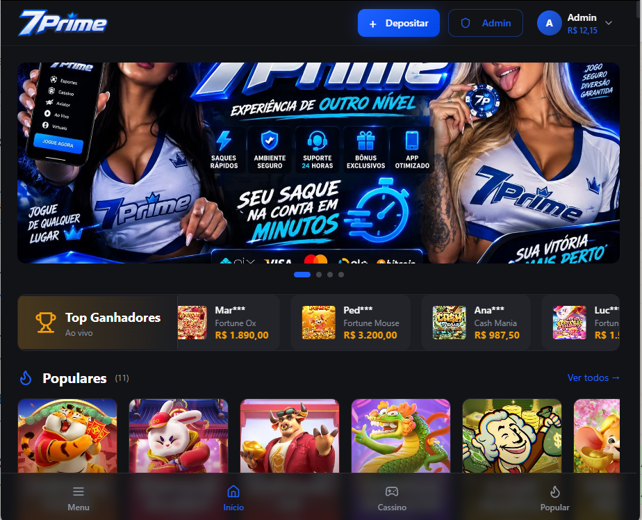

# Bet nacional | Plataforma profissional de cassino para o Brasil

**Sistemas White Label · [Sistemas-Proficional](https://github.com/Sistemas-Proficional)**

[Português](README.md) · [Español](README.es.md) · [English](README.en.md)

Apresentação de um projeto de plataforma de cassino com identidade 7Prime e interface em português. Desenvolvimento e personalização de software para marcas que precisam apresentar seu catálogo de jogos e a experiência do jogador.

**[Solicitar orçamento · WhatsApp](https://wa.me/5511912536227?text=Ol%C3%A1!%20Encontrei%20no%20GitHub%20o%20projeto%20bet-nacional-plataforma-profissional%20e%20gostaria%20de%20solicitar%20um%20or%C3%A7amento.)**

## Imagens do projeto

*Interface 7Prime com banner, catálogo, jogos populares e navegação em português.*

## Interface 7Prime

- Identidade visual azul e preta com a marca 7Prime.
- Banner principal e seção de jogos populares.
- Área de conta com saldo e controles de depósito e administração.
- Faixa de destaques e navegação inferior para as áreas do cassino.

## Personalização e integrações

Esta apresentação aborda a área de cassino. Recursos de apostas esportivas não fazem parte da demonstração descrita. Identidade visual, administração e integrações são avaliadas conforme a necessidade do projeto.

## Solicitar orçamento

Envie o objetivo do projeto, as funcionalidades desejadas, as integrações necessárias e o prazo previsto. Escopo, entrega e condições de acesso ao código são combinados no orçamento.

**[WhatsApp: +55 11 91253-6227](https://wa.me/5511912536227?text=Ol%C3%A1!%20Encontrei%20no%20GitHub%20o%20projeto%20bet-nacional-plataforma-profissional%20e%20gostaria%20de%20solicitar%20um%20or%C3%A7amento.)**

[Conheça meu perfil e outros projetos](https://github.com/Sistemas-Proficional)
