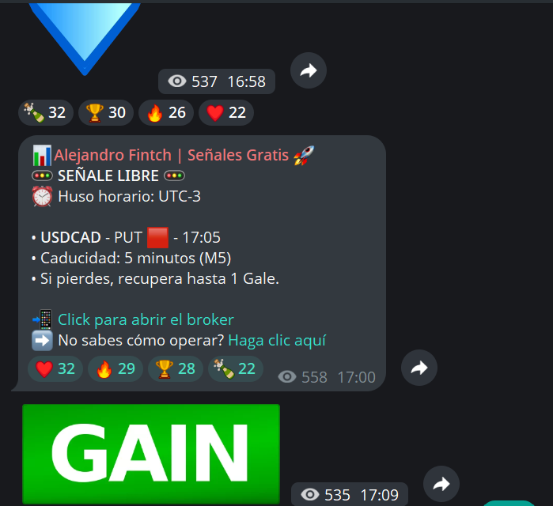

# Bot de Telegram para señales | Automatización de canales y grupos

**Sistemas White Label · [Sistemas-Proficional](https://github.com/Sistemas-Proficional)**

[Português](README.md) · [Español](README.es.md) · [English](README.en.md)

Desarrollo de bots de Telegram y automatización de la distribución de mensajes en canales y grupos. El ejemplo visual presenta una señal en español con información organizada para el lector.

**[Solicitar presupuesto · WhatsApp](https://wa.me/5511912536227?text=%C2%A1Hola!%20Encontr%C3%A9%20en%20GitHub%20el%20proyecto%20bot-sinais-telegram-profissional%20y%20me%20gustar%C3%ADa%20solicitar%20un%20presupuesto.)**

## Imágenes del proyecto

*Ejemplo de mensaje en Telegram: USDCAD, PUT, 17:05, M5 y UTC-3.*

## Formato de mensaje presentado

- Identificación del activo USDCAD y dirección PUT.
- Hora del mensaje y entrada indicadas en el contenido.
- Temporalidad M5 y referencia horaria UTC-3.
- Enlaces de acción para acceder a la plataforma y consultar instrucciones.
- Presentación en español como ejemplo del formato de comunicación.

## Personalización e integraciones

El formato de mensaje descrito es un ejemplo de comunicación, no un informe de desempeño. Los idiomas, la programación, las fuentes de datos y las integraciones se definen según las APIs y el flujo de trabajo del proyecto.

## Solicitar presupuesto

Comparte el objetivo del proyecto, las funcionalidades deseadas, las integraciones necesarias y el plazo previsto. El alcance, la entrega y las condiciones de acceso al código se acuerdan en el presupuesto.

**[WhatsApp: +55 11 91253-6227](https://wa.me/5511912536227?text=%C2%A1Hola!%20Encontr%C3%A9%20en%20GitHub%20el%20proyecto%20bot-sinais-telegram-profissional%20y%20me%20gustar%C3%ADa%20solicitar%20un%20presupuesto.)**

[Conoce mi perfil y otros proyectos](https://github.com/Sistemas-Proficional)
