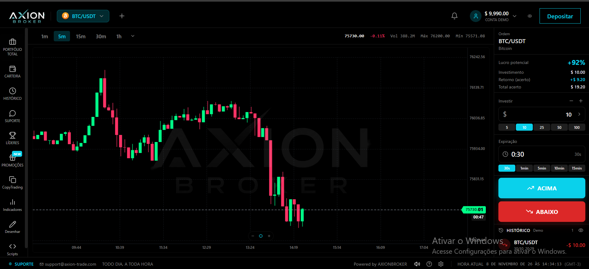

# Corretora de opções binárias white label | Plataforma AXION

**Sistemas White Label · [Sistemas-Proficional](https://github.com/Sistemas-Proficional)**

[Português](README.md) · [Español](README.es.md) · [English](README.en.md)

Portfólio de desenvolvimento de software para corretora de opções binárias white label, com personalização da marca e escopo sob medida. O projeto AXION é apresentado por sua página institucional e pelo terminal de negociação em conta demo.

**[Solicitar orçamento · WhatsApp](https://wa.me/5511912536227?text=Ol%C3%A1!%20Encontrei%20no%20GitHub%20o%20projeto%20corretora-opcoes-binarias-profissional%20e%20gostaria%20de%20solicitar%20um%20or%C3%A7amento.)**

## Imagens do projeto

*Página institucional AXION: identidade visual e apresentação da plataforma.*

*Terminal AXION em conta demo: gráfico BTC/USDT e controles de operação.*

## Telas apresentadas

- Página de apresentação com identidade AXION, navegação e acessos de cadastro e login.
- Terminal demo com gráfico de candles e o ativo BTC/USDT.
- Controles de valor, expiração e direção da operação: Acima e Abaixo.
- Menu lateral com carteira, histórico, indicadores e ferramentas de desenho.

## Personalização e integrações

O terminal apresentado é de conta demo. Saldo e percentuais da interface não são resultados comprovados. Feed de mercado, execução, pagamentos e demais integrações precisam ser definidos e validados no projeto.

## Solicitar orçamento

Envie o objetivo do projeto, as funcionalidades desejadas, as integrações necessárias e o prazo previsto. Escopo, entrega e condições de acesso ao código são combinados no orçamento.

**[WhatsApp: +55 11 91253-6227](https://wa.me/5511912536227?text=Ol%C3%A1!%20Encontrei%20no%20GitHub%20o%20projeto%20corretora-opcoes-binarias-profissional%20e%20gostaria%20de%20solicitar%20um%20or%C3%A7amento.)**

[Conheça meu perfil e outros projetos](https://github.com/Sistemas-Proficional)
